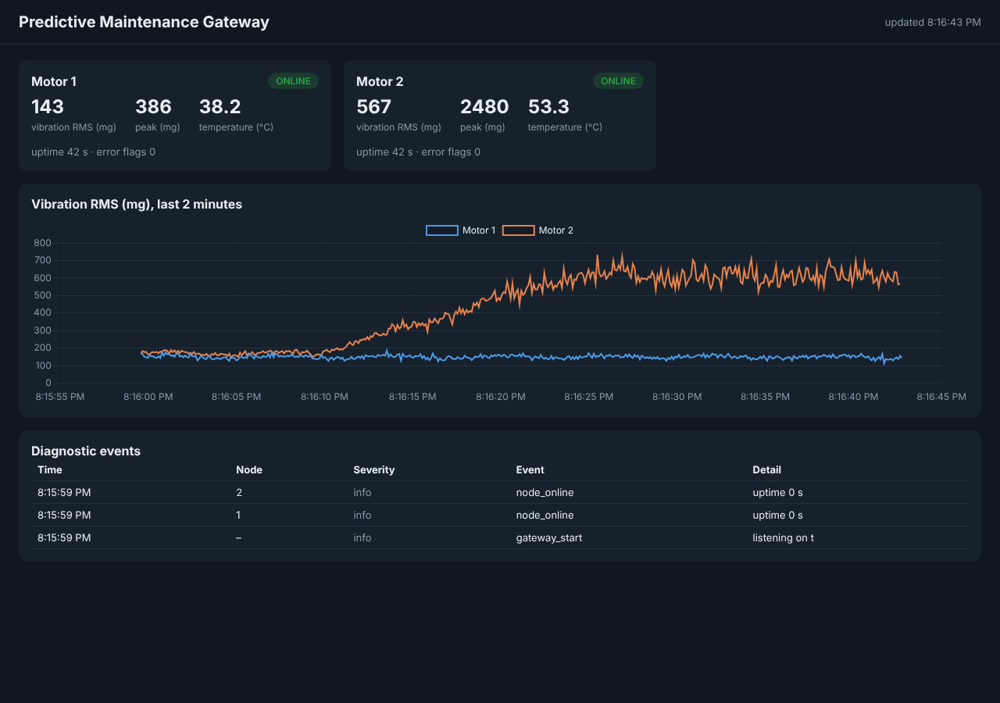

# Gateway and dashboard

```
STM32 nodes ──CAN──► gateway.py ──► SQLite (data/gateway.db) ──► dashboard/app.py ──► browser
(or simulator.py)    decode + diagnostics                        Flask + Chart.js
```

| File | Role |
| --- | --- |
| `protocol.py` | Encode/decode the CAN messages of `docs/PROTOCOL.md` |
| `simulator.py` | Simulates the 2 STM32 nodes (healthy motors, optional fault on one motor) |
| `gateway.py` | Reads the bus (SocketCAN), decodes, stores in SQLite, records diagnostic events |
| `storage.py` | SQLite schema: `vibration`, `temperature`, `heartbeat`, `events` |
| `../dashboard/app.py` | Live web dashboard |

## Run (Ubuntu, virtual CAN bus)

```bash
sudo apt install -y can-utils python3-can python3-flask
./scripts/setup_vcan.sh                      # creates vcan0 (after each reboot)

# terminal 1
python3 gateway/gateway.py
# terminal 2: healthy motors, motor 2 starts degrading after 60 s
python3 gateway/simulator.py --fault 2 --fault-after 60
# terminal 3
python3 dashboard/app.py                     # open http://localhost:5000
```

With real hardware, replace `vcan0` with `can0`: `--channel can0` for the gateway.

## Diagnostic events recorded

| Event | When |
| --- | --- |
| `node_online` / `node_offline` | First heartbeat / no heartbeat for 3 s |
| `error_flag_set` / `error_flag_cleared` | A bit of the heartbeat error flags changes |
| `frames_lost` | Gap in the vibration message counter |
| `temp_sensor` | Temperature status is "not found" or "read error" |



## AI anomaly detection

Install once: `sudo apt install python3-sklearn python3-joblib python3-numpy`.
Train a model as described in `ml/README.md`. When `ml/models/anomaly_model.*`
exist, `gateway.py` scores each motor every second, stores the score in the
`anomaly` table and raises `anomaly_detected` / `anomaly_cleared` events. The
dashboard shows the score, the threshold and an AI badge per motor.
`--no-ai` records data without detection (used to build training sets).
